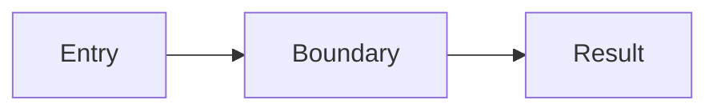

# Explore Report Template

Load before final delivery. Fill in the report, not the braces. Use “none identified” or “unknown (reason)” when appropriate, never invent a value.

````markdown
report_version: 1
report_kind: explore
project: {name and project root}
revision: {commit/version/unknown with reason}
project_type: {code|docs|skill|template|unknown}

## Scope
- Examined: {key materials}
- Omitted: {excluded areas}
- Budget and reason: {actual scope and limits}

## Positioning
{Purpose, audience, learning value, evidence references}

## Structure
{Areas, project-relative paths, roles, evidence references}

## Main path

{Replace this schematic with confirmed relationships. Map edges to evidence IDs.}

## Entry points
- First action: {path and symbol/heading or supported command}
- Expected observation: {what to look for and why}
- Command support: {documented|suggested|unavailable}, source: {evidence ID}
- Execution: {not run|user-reported outcome|observed tool outcome}

## Core designs
{Up to three candidates: problem, location, deep-dive reason, evidence IDs. Fewer is valid.}

## Evidence
- [E1] {path:Symbol/Heading, optional line} — {confirmed|maintainer-stated|inferred|unknown} — {claim}

## Uncertainties
{Unsupported claims, missing material, unknown rationale or untested commands; “none identified” if applicable.}

## Next actions
{Suggested next learning or deep-dive action; no automatic invocation.}
````